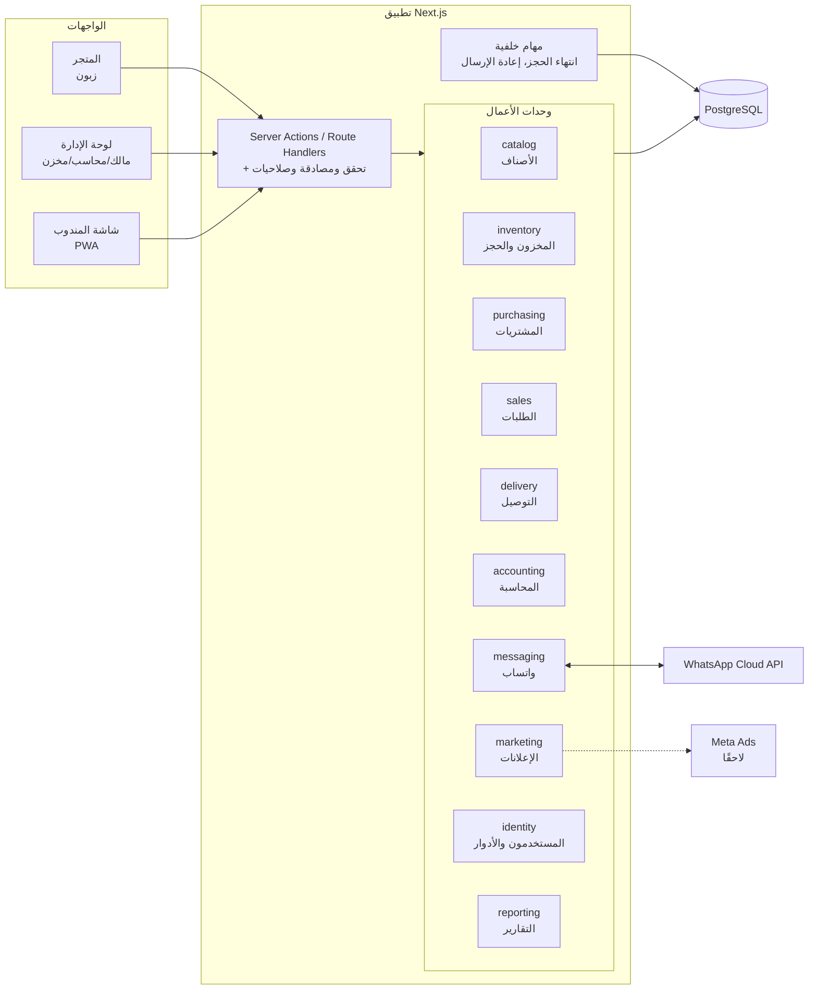
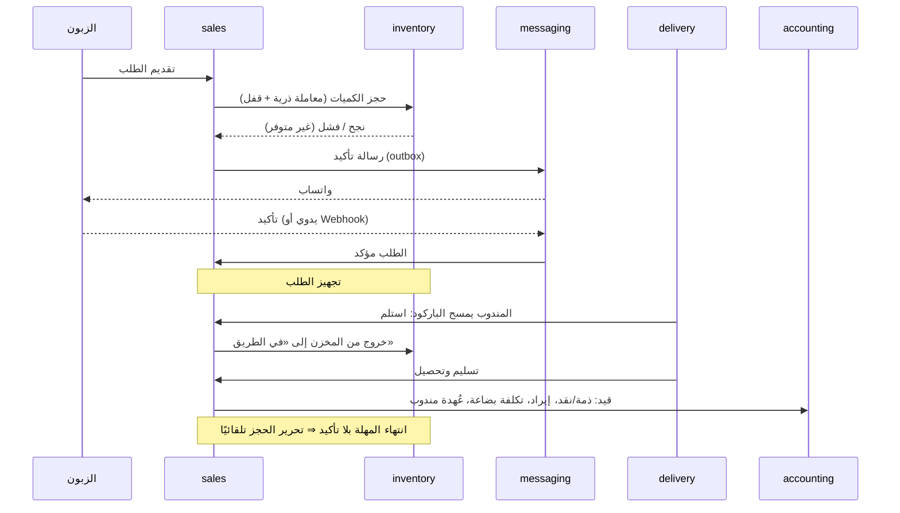

# ARCHITECTURE — معمارية KotaStore

> الحالة: **مقترحة، بانتظار الموافقة**. لا شيء مُنفَّذ أو مُختبر بعد. المبررات التفصيلية في `docs/adr/`.

## 1. المبدأ العام
**تطبيق واحد متجانس مقسّم لوحدات (Modular Monolith)** على Next.js + TypeScript، قاعدة بيانات PostgreSQL واحدة. الأسباب: فريق صغير، حاجة لمعاملات (Transactions) ذرية تربط الحجز بالقيد المحاسبي، وسهولة النشر. الحدود بين الوحدات صارمة حتى يمكن فصل أي وحدة لاحقًا.

## 2. الصورة الكبيرة


## 3. الوحدات ومسؤولياتها
| الوحدة | تملك | لا تفعل |
|---|---|---|
| **catalog** | الأصناف، المتغيرات، الصور، الأسعار، الباركود | لا تعرف الكميات |
| **inventory** | الحركات، الأرصدة، الحجوزات، التسويات | لا تكتب قيودًا مباشرة |
| **purchasing** | الموردون، فواتير الشراء | لا تعدّل الأرصدة إلا عبر inventory |
| **sales** | السلة، الطلبات، دورة حياتها، الباركود | لا تكتب دفتر الأستاذ إلا عبر accounting |
| **delivery** | المناديب، الإسناد، الاستلام/التسليم، العُهدة، التسوية | — |
| **accounting** | دليل الحسابات، القيود، الفترات، العملات، قواعد الترحيل | **الوحيدة** التي تكتب القيود |
| **messaging** | بوابة الرسائل (يدوي/تلقائي)، القوالب، السجل، Webhook | لا تغيّر الطلب إلا عبر sales |
| **marketing** | الحملات، مصاريف الإعلانات، الإسناد (UTM) | — |
| **identity** | المستخدمون، الأدوار، الجلسات | — |
| **reporting** | استعلامات قراءة فقط | لا تكتب بيانات |

**قواعد الحدود:** الوحدات تتخاطب عبر واجهات عامة (Services) فقط؛ ممنوع الاستعلام المباشر على جداول وحدة أخرى؛ **كتابة القيود حصرًا عبر accounting**.

## 4. تدفق الطلب (القلب)


## 5. حالات الطلب (**معدَّلة v5 — ADR-0032**)
**ثلاثة أبعاد مستقلة** بدل حالة واحدة:
- **حالة التنفيذ:** `بانتظار_التأكيد` → `مؤكد` → `مُجهَّز` → `مُرسَل` → `مُسلَّم` أو `مُسلَّم_جزئيًا`. جانبية: `منتهي` · `ملغي` · `فشل_توصيل`.
  (`مُرسَل` تحل محل «مع_المندوب» وتشمل: مندوبًا داخليًا، شركة شحن، استلامًا من المحل.)
- **حالة الدفع:** `غير_مدفوع / جزئي / مدفوع / مردود` — **مشتقة** من جدول `payment`.
- **المرتجع:** كيان `return` بحالاته الخاصة (`مطلوب → مستلَم → مفحوص → مغلق/مرفوض`).
كل انتقال يُسجَّل، وانتقالات غير مسموحة تُرفض باختبار. **جدول واحد موحَّد للأثر على الحجز والمخزون والمحاسبة** (يحلّ التناقض السابق بين هذا الجدول ودليل الحسابات):

### جدول الانتقالات المسموحة (مقترح؛ يُختبر كاملًا في المراحل 7 و9 و10)
| من | إلى | من يفعل / الدالة | أثر على الحجز/المخزون | أثر محاسبي (من 0β) |
|---|---|---|---|---|
| بانتظار_التأكيد | مؤكد | موظف أو رد الزبون (`confirm_order`) | الحجز `expires_at = NULL` (أو إعادة `reserve_stock` إن تأخّر) | — |
| بانتظار_التأكيد | منتهي | النظام (مهلة) | الحجز `expired` | — |
| بانتظار_التأكيد / مؤكد / مُجهَّز | ملغي | موظف (مع سبب) | الحجز `released` | إن وُجد تحويل مسبق مؤكَّد يبقى **2150** حتى الرد/التحويل |
| بانتظار_التأكيد / مؤكد | *(تعديل)* | موظف (`edit_order`) | تحرير فرق الحجز وإعادة حجزه ذريًا | — |
| مُجهَّز | مؤكد | موظف (`edit_order` بعد التجهيز) | كما سبق + تنبيه المخزن | — |
| مؤكد | مُجهَّز | أمين المخزن | الحجز يبقى `active` | — |
| مُجهَّز | **مُرسَل** | **`dispatch_order`**: المندوب (مسح/كود) أو **الإدارة (0α)** | الحجز `consumed` + حركة خروج `dispatch/out_to_courier` بـ`unit_cost` مجمَّدة | **R3:** 1210 / 1200 |
| مُرسَل | مُسلَّم | `complete_delivery` (+ تحصيل) | `delivered_qty = qty` | **R4 + R5** (+ R-fee/R12 إن لزم) |
| مُرسَل | مُسلَّم_جزئيًا | `complete_delivery` بأسطر جزئية | `delivered_qty` للمسلَّم؛ **غير المسلَّم يعود للمخزن** | R4 + R5 على المسلَّم، **R9** على الباقي |
| مُرسَل | فشل_توصيل | المندوب/الشركة (مع سبب) → سطر `delivery_attempt` | — | — |
| فشل_توصيل | مُرسَل | موظف (إعادة محاولة، قد تكون بمندوب آخر) → `delivery_attempt` جديد | — | — |
| فشل_توصيل | ملغي (مع إرجاع المخزون) | موظف + أمين المخزن | حركة إرجاع من «في الطريق» إلى المخزن | **R9** (لا إيراد) |
| مُسلَّم / مُسلَّم_جزئيًا | *(كيان `return`)* | موظف + أمين المخزن + مدير للرد | حركة إرجاع بالتكلفة المجمَّدة (صالح) أو شطب (تالف) | **R10′ + R10′ب** وعكس العمولة |
أي انتقال آخر يُرفض.

### مبدأ التشغيل المتكامل (v5)
1. **دالة واحدة لكل إجراء** (`dispatch_order`, `complete_delivery`, `edit_order`...) تُستدعى من الإدارة أو المندوب أو المهمة الخلفية؛ لا مسارين لنفس الأثر.
2. كل دالة تكتب في **معاملة واحدة**: الحالة، حركة المخزون، الحجز، سجل الحالة، وإشارة الأثر المحاسبي (Outbox) أو القيد نفسه (0β).
3. في 0α المحاسبة غير مفعَّلة، لكن `dispatch_order` تسجّل التكلفة لتُرحَّل رجعيًا في 0β.

## 6. النموذج المحاسبي (ملخص)
- قيد مزدوج: سطور مدين/دائن، مجموعها متساوٍ، يُرفض الترحيل خلاف ذلك.
- المال = **عدد صحيح بأصغر وحدة** + رمز العملة + عدد خانات العملة (بعض العملات 3 خانات).
- القيد المرحَّل لا يُعدّل ولا يُحذف؛ التصحيح بقيد عكسي.
- التفاصيل: `adr/0005`.

## 7. البيانات (كيانات رئيسية، بلا مخطط تفصيلي بعد)
Category · Brand · Product → Variant → (Price, Cost, Barcode, Images) · Customer → Address · DeliveryZone · Payment · StockMovement · StockBalance · Reservation · Supplier · PurchaseInvoice · Order → OrderLine → OrderStatusLog · Courier · Delivery · (كشف عُهدة المندوب يُشتق — v5) · Account · JournalEntry → JournalLine · FiscalPeriod · Currency/ExchangeRate · Campaign · AdSpend · Message · MessageTemplate · User · Role · AuditLog.
مسودة مخطط الجداول في [`DATA-MODEL.md`](DATA-MODEL.md) وتُراجع معك قبل أول ترحيل (المرحلة 2). دليل الحسابات المقترح في [`ACCOUNTING-CHART.md`](ACCOUNTING-CHART.md).

## 8. الحجز بلا بيع مزدوج
- **(معدَّل بالمراجعة)** الحجز دالة PostgreSQL واحدة `reserve_stock` تقفل صفوف الرصيد بترتيب ثابت وتحسب المتاح من جدول `reservations`؛ إن لم يكفِ شيء يفشل الكل. (ADR-0006 الملحق.)
- للحجز مهلة تحسب كسولًا؛ مهمة خلفية تحدّث الحالة للعرض فقط. التحرير يعمل أيضًا عند الإلغاء.
- المتاح الظاهر في المتجر = الموجود − Σ الحجوزات النشطة غير المنتهية.

## 9. المراسلة (واتساب)
- واجهة واحدة `MessageGateway` بمحوّلين: **Manual** (روابط `wa.me` برسالة جاهزة + تسجيل «أُرسلت يدويًا») و**CloudApi** (واتساب Business الرسمي).
- نمط **Outbox**: كل رسالة تُكتب في جدول داخل نفس معاملة الحدث، ثم تُرسل بمهمة خلفية مع إعادة محاولة.
- الواردة عبر Webhook: تحقق من التوقيع، منع التكرار (idempotency)، ربط بالطلب.
- التبديل بين الوضعين بإعداد، دون تغيير باقي النظام.

## 10. الواجهة
- Tailwind + shadcn/ui، مكونات مشتركة في `ui/`، خصائص CSS منطقية (`ms-`/`me-`) لدعم RTL.
- ثلاث «أسطح» بمجموعات مسارات منفصلة: المتجر، الإدارة، المندوب (PWA بملف Manifest وتجربة جوال أولًا).
- مسح الباركود: واجهة BarcodeDetector حين تتوفر، ومكتبة بديلة للمتصفحات الأخرى؛ تتطلب HTTPS.

## 11. الأمان (من اليوم الأول)
- أسرار في متغيرات بيئة فقط، لا في المستودع؛ فحص أسرار في CI.
- Zod (أو مكافئ) للتحقق من كل مدخل؛ ترميز المخرجات؛ CSP.
- RBAC لكل عملية على الخادم (لا يكفي إخفاء الأزرار).
- توقيع Webhook، تحديد المعدل، سجل تدقيق للعمليات المالية.
- كلمات المرور بخوارزمية حديثة (Argon2id أو bcrypt) عبر مكتبة مصادقة معتمدة.

## 12. الاختبار والبناء
Vitest (وحدات)، Playwright (E2E)، اختبارات تزامن على PostgreSQL حقيقي، مصفوفة CI على Linux/Windows/macOS (انظر `adr/0012`).

## 13. بنية المجلدات المقترحة (وصف فقط)
```
src/
  app/            مسارات: (store) (admin) (courier) api
  modules/        catalog inventory purchasing sales delivery accounting messaging marketing identity reporting
  shared/         ui, i18n, money, validation, db, config
docs/  .github/  AGENTS.md
```

## 14. نقاط تحتاج قرارك
انظر `docs/PRD.md` §9 وكل ADR بحالته «مقترح».

## 15. تحديث 15 نوفمبر: النشر السحابي المجاني
- التطبيق (متجر + إدارة + مندوب) على **Cloudflare Workers**، وقاعدة البيانات **Neon**، والصور **R2** (ADR-0014، بانتظار تجربة الجدوى).
- لا عملية خلفية دائمة: انتهاء الحجز يُحسب **كسولًا** عند القراءة، والمهام الدورية للتنظيف وإعادة الإرسال فقط (ADR-0011).
- العملات: دينار ليبي أساسي + دولار بسعر صرف مجمَّد مع كل معاملة (ADR-0005 الملحق).
- بيئتان: `staging` (للاختبار اليدوي) و`production`، بقاعدتَي بيانات منفصلتين (فرعان في Neon).

## 16. تحديث 15 نوفمبر: وحدات جديدة
| الوحدة | المسؤولية | ADR |
|---|---|---|
| **branches/warehouses** (ضمن inventory) | الفروع، المخازن، التحويلات | 0015 |
| **payments** | وسائل الدفع، إثبات التحويل، حالات التأكيد، واجهة البوابة | 0016 |
| **delivery** (موسَّعة) | مندوب داخلي/شركات شحن/استلام، رسوم التوصيل، تسليم نقد المندوب | 0016، 0017 |
| **tracking** | مواقع المناديب، الاحتفاظ والخصوصية | 0018 |
| **assistant** | بوت القواعد + النموذج اللغوي (قراءة فقط) | 0019 |
| **accounting/simple** | واجهة المحاسبة المبسطة وفحوص السلامة | 0020 |
| **pos** | الورديات والمبيعات الفورية والإيصالات | 0021 |
| **reporting** (موسَّعة) | جداول ملخصة وداشبورد | 0022 |
| **backup** | نسخ مجدولة مشفرة وتصدير واسترجاع | 0023 |

**قاعدة:** البوت يقرأ عبر خدمات القراءة فقط؛ لا صلاحية كتابة له.

## 17. تحديث 15 نوفمبر (مراجعة): وحدات وقرارات إضافية
| الوحدة | المسؤولية | ADR |
|---|---|---|
| **customers** (ضمن sales) | الزبائن، العناوين، الحالة، السقوف | 0024 |
| **notifications** | إشعارات الموظفين عبر Outbox | 0025 |
| **import** | استيراد CSV وأرصدة افتتاحية | 0026 |
| **observability** (مشتركة) | سجلات مقنَّعة، صحة، أخطاء، احتفاظ | 0027 |

**قاعدة تشغيل على Workers:** العمليات الحرجة متعددة الخطوات = دالة PostgreSQL واحدة (ADR-0003). إن لم يتسع تطبيق واحد في حدود المنصة يُقسَّم نشريًا إلى مسارين (ADR-0002 الملحق).

## 18. تحديث v5: تكامل المبيعات والمحاسبة والتشغيل (ADR-0032)
| البند | التغيير |
|---|---|
| الحالات | فصل التنفيذ/الدفع/المرتجع؛ «مُرسَل» بدل «مع_المندوب»؛ إضافة `مُسلَّم_جزئيًا` (§5) |
| الدوال الذرية | `edit_order`, `dispatch_order`, `complete_delivery` + تحصين `adjust_stock` بالحجوزات |
| sales | يملك الطلب الإداري، التعديل، الدفعات، المرتجعات |
| delivery | يملك `delivery_attempt`، `cash_handover_line`، العمولات، (لاحقًا) تسوية الشحن |
| accounting | قواعد v5 (ACCOUNTING-CHART §5): R4 العامة، R8′/R8″، R10′، R10′ب، العمولة، حسابا 1140 و2150 |
| كشف عُهدة المندوب | يُحسب بالاستعلام (دفعات نقدية − سطور تسليم مؤكَّدة) لا بجدول `CourierCashLedger` منفصل (يُحذف من §7) |
| تقاطع الوحدات | لا تغيير: كتابة القيود حصرًا عبر accounting، والمخزن حصرًا عبر inventory |
