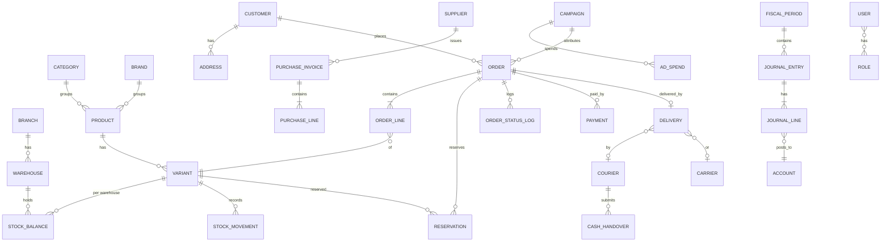

# DATA-MODEL — مسودة نموذج البيانات

> **v5:** يوجد «ملحق v5» في آخر الملف (تكامل المبيعات والمحاسبة والتشغيل، ADR-0032) **يحلّ محل** ما يتعارض معه أعلاه (حالات الطلب، `totals`، `delivery` 1:1، `cash_handover`). الأصل أعلاه يبقى مرجعًا تاريخيًا.
> الحالة: **مسودة للمراجعة معك قبل أول ترحيل (المرحلة 2)**. لا شيء منها مُنفَّذ أو مُختبر. أسماء الجداول والأعمدة بالإنجليزية (AGENTS §5). كل مبلغ = عدد صحيح بأصغر وحدة + `currency` (ADR-0005).

## 1. المخطط العام (الكيانات الرئيسية)

## 2. الجداول الأساسية وقيودها المطلوبة في القاعدة
| الجدول | أهم الأعمدة | قيود/فهارس (تُفرض في القاعدة) |
|---|---|---|
| `branch`, `warehouse` | id، name، `branch_id` للمخزن، `is_default` | مخزن افتراضي واحد على الأقل |
| `category`, `brand` | id، name_ar، name_en، slug | `slug` فريد |
| `product` | id، category_id، brand_id، name_ar/en، slug، status | `slug` فريد |
| `variant` | id، product_id، `sku`، `barcode`، attributes (مقاس/لون)، `price_minor`، `price_currency`، `cost_minor` | `sku` فريد، `barcode` فريد حين يوجد، `price_minor >= 0` |
| `stock_balance` | `(warehouse_id, variant_id)`، `on_hand` | PK مركّب، `on_hand >= 0` (CHECK) |
| `stock_movement` | id، `type` (opening/purchase/out_to_courier/return/adjust/count/transfer_out/transfer_in/pos_sale)، qty (موقّع)، warehouse، variant، ref | **إضافة فقط** (لا UPDATE/DELETE — محفِّز يمنع)، فهرس `(warehouse, variant, created_at)` |
| `reservation` | id، order_id، warehouse_id، variant_id، qty، `status` (active/consumed/released/expired)، `expires_at` | `qty > 0`؛ فهرس جزئي `status='active'`؛ يُنشأ فقط عبر `reserve_stock` (ADR-0006) |
| `customer` | id، `phone_e164` (فريد)، name، `status` (normal/watch/blocked)، counters | `phone_e164` فريد ومُتحقَّق الصيغة |
| `address` | id، customer_id، zone_id، text، ملاحظات | — |
| `delivery_zone` | id، name، fee_minor، fee_currency، `fee_payer_default` | — |
| `order` | id، `number` (فريد)، customer_id، branch_id، warehouse_id، `status`، totals (minor)، currency، `exchange_rate_frozen` (إن لزم)، `source` (UTM)، timestamps | `number` فريد؛ انتقالات الحالة تُفرض بدالة/محفِّز |
| `order_line` | order_id، variant_id، qty، unit_price_minor، unit_cost_minor (مجمَّد عند التسليم) | `qty > 0` |
| `order_status_log` | order_id، from، to، by، at، reason | إضافة فقط |
| `payment` | id، order_id، method (cash/transfer/card)، amount_minor، currency، `status` (pending/confirmed/rejected)، proof_ref، **`collected_by`** (user)، confirmed_by | `confirmed_by ≠ collected_by` (CHECK/منطق) |
| `delivery` | id، order_id، mode (courier/carrier/pickup)، courier_id/carrier_id، fee_minor، `fee_payer`، tracking_no | — |
| `cash_handover` | id، courier_id (**ويربط `courier.user_id`**)، amount_minor، status (pending/confirmed/rejected)، confirmed_by، difference_minor | `confirmed_by ≠ courier.user_id` (CHECK بعد الربط) |
| `account` | id، code، name_ar/en، type، is_active | `code` فريد |
| `journal_entry` | id، period_id، date، ref_type/ref_id، `posted_at`، `reversal_of` | **لا UPDATE/DELETE بعد الترحيل**؛ فريد `(ref_type, ref_id, rule)` لمنع القيد المزدوج لنفس الحدث |
| `journal_line` | entry_id، account_id، `debit_minor`، `credit_minor`، currency، `fx_rate_micro`، `functional_minor`، branch_id | CHECK: أحدهما صفر؛ **مجموع المدين = مجموع الدائن لكل قيد** (محفِّز مؤجَّل عند الترحيل) |
| `fiscal_period` | id، from، to، `status` (open/closed) | منع الترحيل في المقفلة |
| `exchange_rate` | pair، `rate_micro`، `effective_from`، entered_by | **غير قابل للتعديل**؛ إضافة فقط |
| `campaign`, `ad_spend` | منصة، فترة، مبلغ، عملة، سعر مجمَّد | — |
| `message`, `message_template`, `outbox` | قناة، اتجاه، حالة، محاولات، `idempotency_key` | `idempotency_key` فريد |
| `notification` | حدث، قناة، حالة، `dedupe_key` | `dedupe_key` فريد |
| `user`, `role`, `permission`, `user_branch` | RBAC + نطاق الفرع | — |
| `audit_log` | actor، action، entity، before/after (مقنَّع)، at | إضافة فقط |
| `courier_location` | courier_id، lat، lng، at | حذف بعد مدة الاحتفاظ |

## 3. قواعد عامة
- المفاتيح: UUID (أو ULID) لا أرقام تسلسلية متوقعة للكيانات المكشوفة؛ **رقم الطلب** قصير قابل للقراءة (ADR-0008) منفصل عن المفتاح.
- كل جدول مالي/مخزني: `created_at`، `created_by`، `branch_id` حيث يلزم.
- **حذف ناعم** للكيانات التشغيلية (منتج، زبون)؛ **لا حذف** للمالية والمخزنية.
- ترقيم الفواتير لكل فرع بلا فجوات (POS): تسلسل قاعدة بيانات لا يضمن عدم الفجوات عند الفشل؛ يحتاج جدول عدّاد مقفول داخل المعاملة — **يُصمَّم ويُختبر في المرحلة 15**.

## 4. ما يحتاج قرارك قبل التثبيت
1. التكلفة: متوسط على مستوى الشركة أم لكل مخزن (ADR-0015 البند 6).
2. هل `variant.cost_minor` الحالي يُخزَّن أم يُشتق دائمًا من حركات الشراء؟ (المقترح: يُخزَّن ويُحدَّث بقاعدة موثّقة داخل `inventory`.)
3. تحميل الضريبة (إن وُجدت) على سطر الطلب: عمود `tax_minor` ولا يُضاف قبل حسم سؤال الضريبة (PRD §10).

---
## ملحق v4 (بعد التحليل المفصَّل) — تصحيحات وإضافات مقترحة
> كلها **مقترحة وغير مُنفَّذة وغير مُختبرة**، وتُراجع معك قبل أول ترحيل (المرحلة 2).

### أ) تصحيحات
1. **`payment.collected_by`** أُضيف: قيد `confirmed_by ≠ collected_by` لم يكن له عمود.
2. **`courier.user_id`** إلزامي: وإلا لا يعمل قيد فصل الواجبات في `cash_handover`.
3. **موقع «في الطريق»:** `stock_balance` صار على `stock_location` بدل `warehouse` فقط: `(location_id, variant_id, on_hand)`، حيث `location` نوعه `warehouse` أو `courier_custody` (واحد لكل مندوب). حركة `out_to_courier` تنقل من مخزن إلى عهدة مندوب، فيُعرف ماذا يحمل كل مندوب ويطابق حساب 1210 مجموع عُهَد المناديب.
4. **تجميد التكلفة عند الخروج للمندوب لا عند التسليم:** `stock_movement.unit_cost_minor` يُسجَّل عند `out_to_courier`، و`order_line.unit_cost_minor` تنسخه، وقاعدتا R3 وR5 تستعملان **القيمة نفسها** (انظر ACCOUNTING-CHART). السبب: فاتورة شراء تصل بين الحدثين تغيّر المتوسط فلا يتصفّر 1210.
5. **`order.idempotency_key`** (فريد): يمنع إنشاء طلبين من نقرة مزدوجة أو إعادة محاولة.

### ب) كيانات ناقصة مقترحة
| الجدول | الغرض |
|---|---|
| `product_image` | صور المتغيرات/المنتج (مفتاح R2، ترتيب، alt) |
| `setting` | إعدادات النظام (مهل الحجز، سقوف، ساعات العمل) بسجل تدقيق |
| `discount` / `order_discount` | خصومات وكوبونات؛ توزيعها على الأسطر بقاعدة التقريب |
| `order_line.tax_minor` | بعد حسم سؤال الضريبة فقط |
| `purchase_cost` | تكاليف إضافية على الفاتورة (شحن، جمارك، تخليص) توزَّع على أسطرها ← التكلفة الواصلة (landed cost) |
| `supplier_payment` | دفعات الموردين (تقابل R2) |
| `return` / `return_line` | مرتجع **بعد** التسليم (يختلف عن فشل التوصيل) |
| `stocktake` / `stocktake_line` | جلسات الجرد قبل التسوية |
| `expense` | مصروفات تشغيل عامة (إيجار، كهرباء) تُنتج قيدًا عبر accounting |

### ج) قرار مطلوب منك
هل تُخزَّن التكلفة المتوسطة على مستوى الشركة أم لكل مخزن؟ (البند 1 في «ما يحتاج قرارك»). الافتراض الحالي: **على مستوى الشركة** لأنه أبسط، ويمكن تغييره قبل المرحلة 4 فقط.

---
## ملحق v5 (تكامل المبيعات والمحاسبة والتشغيل — ADR-0032)
> **مقترح، غير منفَّذ، غير مُختبر.** يُراجع معك ومع المحاسب قبل أول ترحيل (المرحلة 2). يحلّ محل ما يتعارض معه أعلاه.

### أ) `order` — تفكيك الإجمالي وفصل الحالات
| العمود | ملاحظة / قيد |
|---|---|
| `status` | **حالة التنفيذ فقط:** `pending_confirmation, confirmed, prepared, dispatched, delivered, partially_delivered, delivery_failed, cancelled, expired` |
| `channel` | `web / admin / pos` |
| `created_by` | موظف الطلب الإداري، أو NULL للويب |
| `subtotal_minor` | مجموع (qty × unit_price) للأسطر |
| `discount_total_minor` | ≥ 0 |
| `delivery_fee_minor` | ≥ 0 (نسخة مجمَّدة من المنطقة عند الطلب) |
| `tax_total_minor` | 0 افتراضيًا؛ لا يُفعَّل قبل حسم سؤال الضريبة |
| `rounding_minor` | فرق التقريب الموثَّق |
| `grand_total_minor` | **CHECK:** `= subtotal − discount_total + delivery_fee + tax_total + rounding` |
| `paid_total_minor` | مجموع الدفعات المؤكَّدة (يُحدَّث داخل المعاملة نفسها؛ فحص سلامة يطابقه مع `payment`) |
| `balance_due_minor` | `= grand_total − paid_total` (CHECK) |
| `edit_version` | يزيد مع كل `edit_order` |
| `idempotency_key` | فريد (من v4) |
> **حالة الدفع** `unpaid/partial/paid/refunded` **مشتقة** (عرض أو عمود محسوب) من `payment` ولا تُدخَل يدويًا.

### ب) `order_line`
`qty`, `delivered_qty`, `returned_qty` (CHECK: `delivered_qty + returned_qty <= qty` وكلها ≥ 0)، `unit_price_minor`, `line_discount_minor`, `unit_cost_minor` (يُنسخ عند `dispatch_order` ولا يتغير)، وَ`tax_minor` (بعد حسم الضريبة).

### ج) `payment` (معدَّل)
دفعات متعددة/جزئية. أعمدة إضافية: `is_prepaid` (قبل التسليم)، `delivery_id` (اختياري)، `refund_of` (دفعة ردٍّ لمرتجع). القيد القائم `confirmed_by ≠ collected_by` يبقى.

### د) جداول التوصيل والتحصيل
| الجدول | الأعمدة الأساسية | قيود |
|---|---|---|
| `courier` | id، `user_id` (**إلزامي وفريد**)، branch_id، commission_type (`none/fixed/percent`)، commission_value، is_active | `user_id` فريد |
| `carrier` | id، name، contact، fee_policy، is_active | — |
| `delivery` (ملخص) | id، order_id (فريد)، mode (`courier/carrier/pickup`)، fee_minor، `fee_payer` (`customer/company`)، current_attempt_id | 1:1 مع الطلب كملخص فقط |
| `delivery_attempt` | id، delivery_id، attempt_no، courier_id/carrier_id، dispatched_at، outcome (`delivered/failed/returned/pending`)، failure_reason، carrier_tracking_no، cost_minor | **إضافة فقط**؛ `(delivery_id, attempt_no)` فريد |
| `cash_handover` | id، courier_id، amount_minor، status، confirmed_by، difference_minor | `confirmed_by ≠ courier.user_id` |
| `cash_handover_line` | handover_id، `payment_id` (فريد)، amount_minor | **كل دفعة نقدية تُسلَّم مرة واحدة فقط**؛ مجموع السطور = المبلغ المُصرَّح؛ مجموع المؤكَّد + الفرق = مجموع السطور |
| `courier_commission` | id، courier_id، order_id، delivery_attempt_id، amount_minor، status (`accrued/paid/reversed`)، settled_ref | فريد `(order_id, courier_id)` للاستحقاق؛ يُعكس عند المرتجع |

> هذا يعوّض اختفاء `CourierCashLedger` المذكور في ARCHITECTURE §7: **كشف عُهدة المندوب = الدفعات النقدية المحصَّلة − `cash_handover_line` المؤكَّدة**، يُحسب بالاستعلام لا بجدول منفصل. (قرار مقترح؛ يُعاد النظر إن ثبت بطؤه في 1A.)

### هـ) المرتجعات وتعديل الطلب
| الجدول | الأعمدة | قيود |
|---|---|---|
| `return` | id، order_id، reason، status (`requested/received/inspected/closed/rejected`)، refund_method (`cash/transfer/credit/none`)، received_by، approved_by | الموافقة والرد بصلاحية مدير |
| `return_line` | return_id، order_line_id، qty، `condition` (`resellable/damaged`)، `unit_cost_minor` (**منسوخ من سطر الطلب**) | `qty > 0`، مجموع المرتجع لسطر ≤ `delivered_qty` |
| `order_edit_log` | id، order_id، edit_version، before (jsonb، مقنَّع)، after، actor، reason، at | **إضافة فقط** |

### و) كيانات مالية مساندة
| الجدول | الغرض |
|---|---|
| `sales_document` | إيصال/فاتورة/إشعار دائن، ترقيم بلا فجوات لكل فرع (عدّاد مقفول، كما في POS). **يُنشأ فقط إن أقرّه المحاسب** |
| `carrier_settlement` + `carrier_settlement_line` | تسوية COD وأجور الشحن (الإصدار 2) |
| `bank_statement_line` | سطور كشف البنك/المحفظة وربطها بدفعة مؤكَّدة (الإصدار 1) |

### ز) تصحيح الجداول الموصوفة في v4
- `courier` و`carrier` لم تكونا معرَّفتين في الجدول §2؛ صارتا معرَّفتين أعلاه.
- `delivery` لم تعد تحمل وحدها حالة التوصيل (تاريخ المحاولات في `delivery_attempt`).
- حركة المخزون `out_to_courier` تُسمَّى أيضًا **`dispatch`** عند الإرسال لشركة/استلام؛ تسجّل دائمًا `unit_cost_minor` (شرط المرحلة 4 للترحيل الرجعي).
- الحجز لا يتجاوز `on_hand`: جرد/تسوية/تحويل يخفض `on_hand` دون الحجوزات النشطة **يُرفض أو يمرّ بقرار صريح** (ADR-0032 §2).

### ح) فحوص سلامة تُفرض أو تُراقب
| الفحص | أين |
|---|---|
| `grand_total` يطابق الأسطر والمكوّنات | قيد CHECK + اختبار خصائص |
| `paid_total = Σ دفعات مؤكَّدة` | فحص يومي (لوحة السلامة) |
| `delivered_qty + returned_qty ≤ qty` | CHECK |
| كل دفعة نقدية مسلَّمة تظهر في سطر تسليم واحد على الأكثر | UNIQUE |
| لا حجز `active` لطلب منتهٍ/ملغي | فحص يومي |
