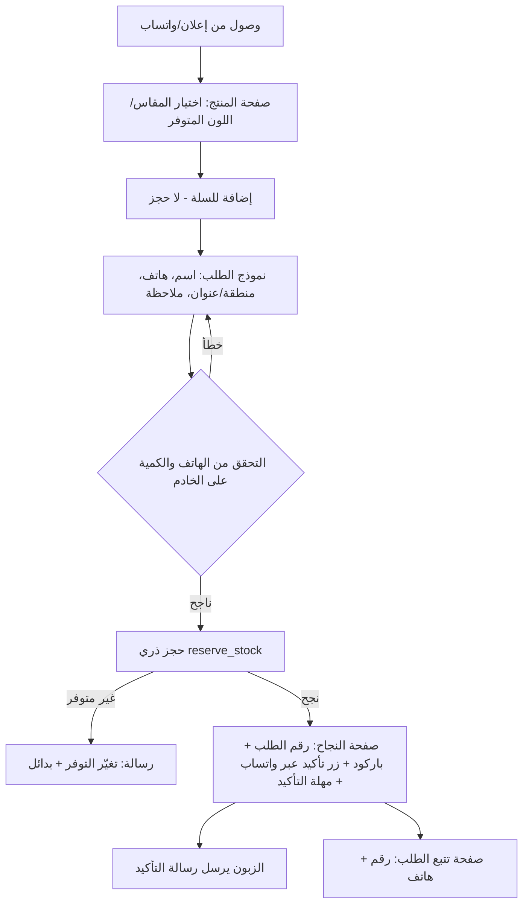
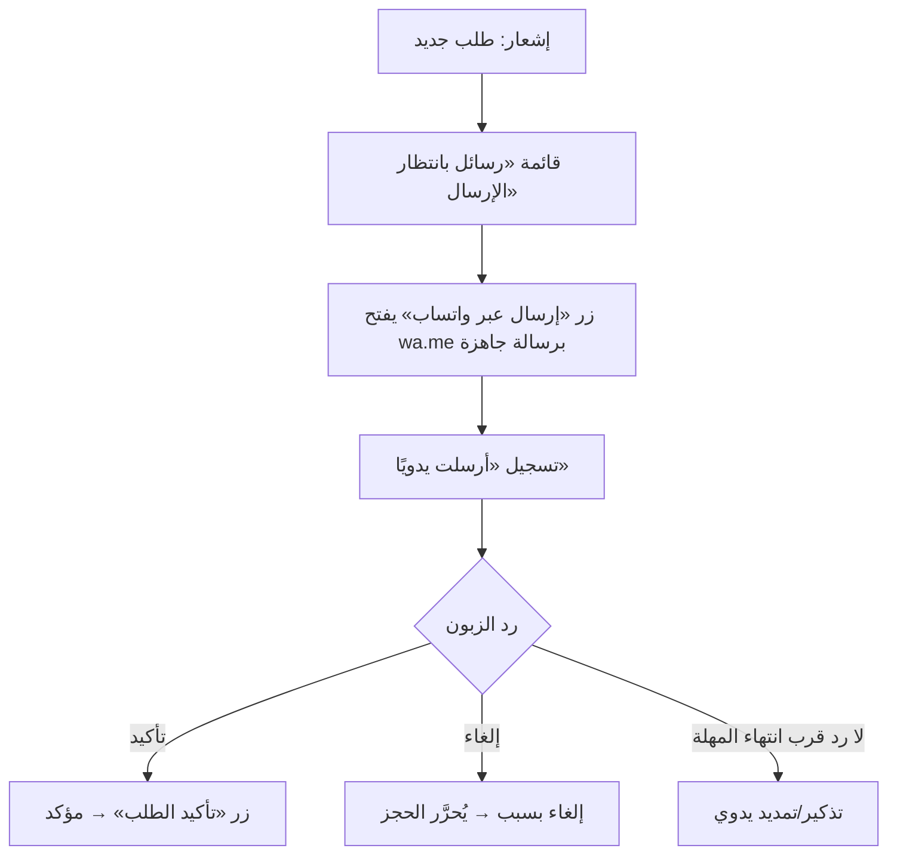
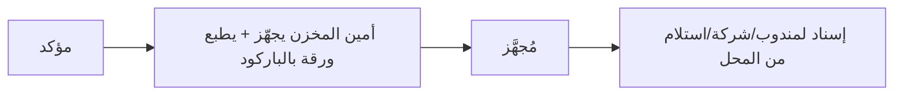
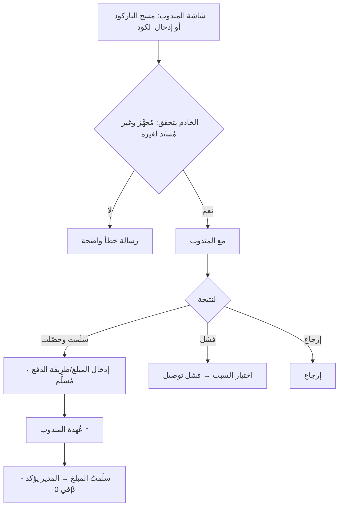
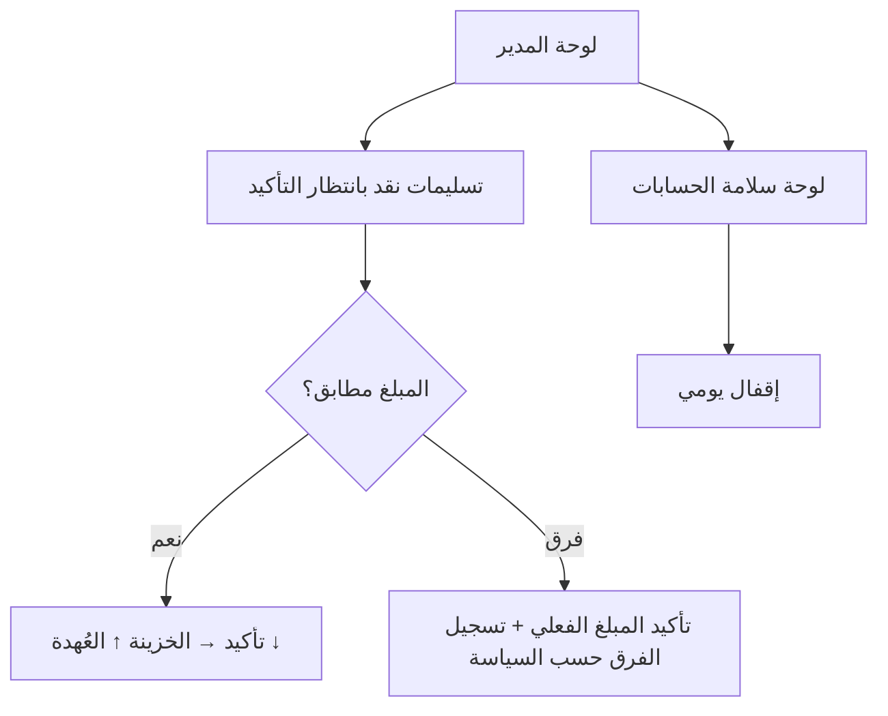
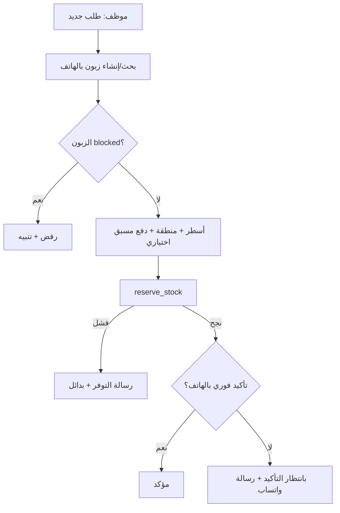
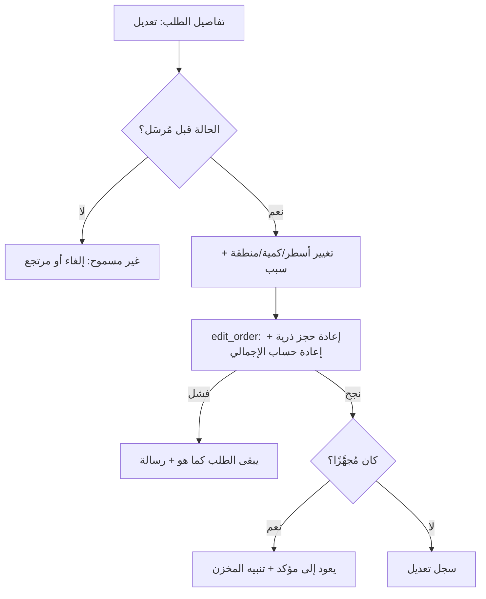
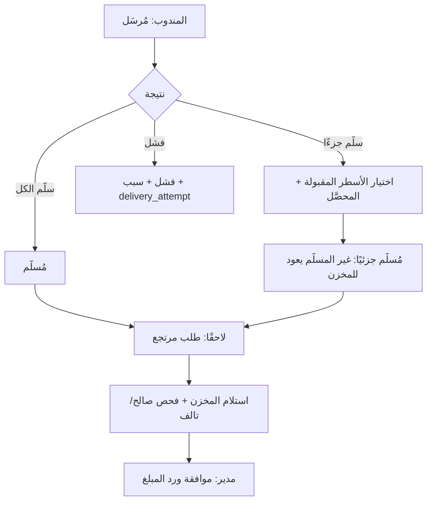

# UX-FLOWS — تدفقات المستخدم وهياكل الشاشات الأولية

> الحالة: **مسودة أولية للمراجعة** (v3). هياكل نصية لا تصاميم بصرية؛ التصميم البصري يُنجز بعد موافقتك (أدوات تصميم). **لم تُختبر مع مستخدمين.** كل الشاشات RTL أولًا وللجوال أولًا.

## 1. التدفقات الخمسة

### تدفق 1: الزبون يطلب (المتجر)

### تدفق 2: الموظف يؤكد الطلب (واتساب يدوي)

### تدفق 3: التجهيز والإسناد

### تدفق 4: المندوب يستلم ويسلّم

### تدفق 5: المحاسب/المدير يراجع اليوم

## 2. هياكل الشاشات (عناصر وترتيب، من الأعلى للأسفل على الجوال)

### أ) المتجر — صفحة المنتج
شريط علوي (شعار، بحث، سلة، تبديل لغة) · معرض صور قابل للتمرير · الاسم · السعر · **محدد المقاس/اللون** (المتوفر فقط؛ غير المتوفر معطَّل مع تلميح) · الكمية · زر «أضف للسلة» ثابت أسفل الشاشة · الوصف · سياسة التوصيل والإرجاع · منتجات مشابهة · زر دردشة/بوت لاحقًا.

### ب) المتجر — إتمام الطلب
ملخص السلة القابل للطي · الاسم · الهاتف (تحقق فوري بالصيغة) · المنطقة (تحدد رسوم التوصيل) · العنوان · ملاحظات · طريقة الدفع (عند الاستلام؛ تحويل لاحقًا) · الإجمالي مع رسوم التوصيل · زر «تأكيد الطلب» · نص يوضح مهلة التأكيد.

### ج) الإدارة — قائمة الطلبات
شريط فلاتر (الحالة، التاريخ، الفرع، القناة، البحث بالرقم/الهاتف) · جدول (على الجوال بطاقات): رقم، زبون (هاتف مقنَّع حسب الصلاحية)، الحالة، الإجمالي، المهلة المتبقية (عدّاد)، زر الإجراء التالي · شارة تحذير لزبون `watch/blocked`.

### د) الإدارة — تفاصيل الطلب
رأس: الرقم + الحالة + أزرار الانتقالات المسموحة فقط · الزبون والعنوان · البنود مع المتوفر · الدفع · سجل الحالات (من/متى/لماذا) · الرسائل (واتساب) · قسم التوصيل والإسناد · (0β) القيود الناتجة وزر «اشرح القيد».

### هـ) شاشة المندوب
**الرئيسية:** زر مسح كبير + حقل إدخال الكود + قائمة «طلباتي اليوم» بحالاتها + رصيد العُهدة (قراءة فقط) · **بعد المسح:** بطاقة الطلب (الزبون، العنوان، الإجمالي المطلوب تحصيله) · أزرار كبيرة: «سلّمت وحصّلت» / «فشل» / «إرجاع» · إدخال المبلغ مع تأكيد قبل الإرسال · (لاحقًا) زر بدء/إنهاء التتبع.

## 2ب. إضافات v5 (تدفقات وشاشات المبيعات المتكاملة — مقترحة)

### تدفق 6: طلب إداري (هاتف/واتساب)

### تدفق 7: تعديل الطلب

### تدفق 8: التسليم الجزئي والمرتجع

### شاشات الإدارة المضافة/المعدَّلة (v5)
| الشاشة | تبويباتها وعناصرها |
|---|---|
| **قائمة الطلبات** | تبويب لكل حالة تنفيذ؛ عمود حالة الدفع المشتقة؛ فلتر القناة (web/admin/pos)؛ عدّاد المهلة |
| **طلب جديد (إداري)** | بحث/إنشاء زبون · أسطر مع التوفر · المنطقة (تحدد الرسوم) · الدفع المسبق · «تأكيد فوري» بصلاحية · الإجمالي المفكَّك |
| **تفاصيل الطلب** | **ملخص** · **البنود** (+تعديل) · **الدفعات** (حالة التأكيد، من حصّل) · **التوصيل ومحاولاته** · **الرسائل** · **المرتجعات** · **القيود** (0β) · **السجل** (حالات + تعديلات) |
| **المرتجعات** | قائمة بحالاتها · نموذج إنشاء من طلب مسلَّم · استلام وفحص (صالح/تالف) · رد المبلغ بصلاحية مدير |
| **الزبائن** | سجل الطلبات والعدّادات · تغيير الحالة بسبب · دمج مكررين · ملاحظات داخلية |
| **نقد المناديب** | عُهدة كل مندوب · تسليمات بانتظار التأكيد مع **سطور الدفعات** · تأكيد المبلغ الفعلي والفرق · العمولات المستحقة |
| **الخصومات** | قواعد وكوبونات وصلاحيات · عرض توزيع التقريب |
| **المطابقة** (إصدار 1) | كشف البنك/المحفظة مقابل التحويلات المؤكَّدة |
| **لوحة السلامة** | فحوص ACCOUNTING §5.3 وTESTING §v5 مع ما يحتاج تصحيحًا |

### شاشة المندوب (إضافات v5)
بعد المسح: أسطر الطلب مع خانات «سلّمت/لم أسلّم» لكل سطر · المبلغ المطلوب = ما بقي بعد الدفع المسبق (يظهر «مدفوع مسبقًا» ولا يُطلب تحصيله) · زر «فشل» يسجّل محاولة بسبب · كشف العُهدة والعمولة المستحقة (قراءة فقط).

## 3. مبادئ
أهداف لمس ≥ 44px · RTL منطقي · نص قصير واضح بالعربية · لا خطأ بلا رسالة قابلة للتصرف (ADR-0030) · حالة الطلب ظاهرة دائمًا · الإجراء الخطر (إلغاء، رفض تأكيد) يطلب تأكيدًا وسببًا.

## 4. الخطوة التالية
بعد موافقتك على هذه التدفقات: تصميم بصري عالي الدقة لشاشات المتجر وإدارة الطلبات والمندوب (أداة تصميم)، ثم اختبار قابلية استخدام مع مندوب وموظف حقيقيين على نموذج أولي.
