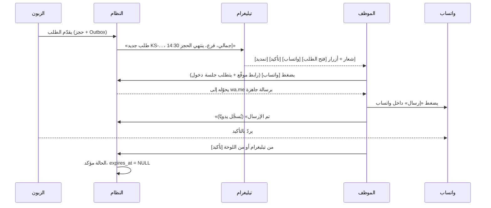

# ADR-0025: إشعارات الموظفين
الحالة: مقترح

## السياق
واتساب API غير متوفر، والإطلاق بالوضع اليدوي: لا أحد يعلم بوصول طلب جديد إلا بفتح اللوحة، والحجز له مهلة تنتهي. فجوة تشغيلية وُجدت في المراجعة (15 نوفمبر).

## الخيارات
| القناة | المزايا | العيوب |
|---|---|---|
| **تيليغرام (بوت)** | مجاني، فوري، يعمل على كل الأجهزة، سهل | يتطلب أن يستخدمه الموظفون؛ التوفر والحظر في ليبيا **لم أتحقق منه** |
| **إشعارات PWA (Web Push)** | بلا تطبيق إضافي | على iPhone تعمل فقط للتطبيق المثبَّت وبإصدارات حديثة؛ موثوقيتها تُجرَّب |
| **بريد إلكتروني** | بسيط وشبه مضمون | بطيء الانتباه |
| **تنبيه داخل اللوحة (صوت + شارة)** | بلا تبعيات | لا يعمل والصفحة مغلقة |

## القرار المقترح
واجهة `Notifier` بمحوّلات: **لوحة داخلية** (دائمًا)، ثم **تيليغرام** و**Web Push** و**بريد** كقنوات اختيارية تُفعَّل بإعداد. كلها عبر **Outbox** نفسه (ADR-0011) بإعادة محاولة.

**الأحداث:** طلب جديد، حجز يقترب من الانتهاء، مخزون منخفض، تسليم نقد بانتظار التأكيد، تحويل بانتظار التأكيد، عُهدة متأخرة، فشل أو تأخر النسخ الاحتياطي، تنبيه سلامة حسابات.

**الخصوصية:** نص الإشعار الخارجي **أدنى ما يلزم**: رقم الطلب والإجمالي والفرع؛ لا اسم ولا هاتف ولا عنوان كامل. التفاصيل داخل اللوحة بعد الدخول.
**الأسرار:** رمز بوت تيليغرام ومفاتيح Push متغيرات بيئة فقط.

## المخاطر
إغراق بالتنبيهات: تجميع وحدود وتفضيلات لكل مستخدم. اعتماد على خدمة طرف ثالث: لذلك القناة الداخلية هي الأساس.

## ما لم يُختبر
كل شيء. اختبارات: إشعار واحد لكل حدث (idempotent)، لا بيانات شخصية في النص الخارجي، فشل الإرسال يُعاد ثم يُصعَّد. يدوي: وصول إشعار طلب جديد على جوالك.

---
## ملحق v4: بوت تيليغرام بالتفصيل (التدفق، الحالات، المندوب)
> كله **مقترح ولم يُختبر**. توفر تيليغرام في ليبيا وحدود الخطة المجانية **لم أتحقق منها**.

### 1) ما يفعله البوت وما لا يفعله
| يفعل | لا يفعل |
|---|---|
| ينبّه الموظفين بالأحداث (جدول §4) | **لا يرسل رسائل واتساب** ولا يستقبل ردود الزبائن |
| يعرض أزرارًا لإجراءات خفيفة محددة (§3) | لا يؤكد مبالغ مالية (نقد/تحويل) ولا يلغي طلبًا |
| يفتح روابط موقّعة لصفحات الإدارة | لا يحمل اسم الزبون ولا هاتفه ولا عنوانه في نصوصه |
| يرسل ملخصًا يوميًا للمالك | لا يتتبع الموقع (لا «الموقع المباشر» في تيليغرام) |
البوت **قناة تنبيه وتحكم سريع**؛ واتساب يبقى قناة الزبون.

### 2) الإعداد والربط
1. إنشاء البوت عند BotFather؛ الرمز `TELEGRAM_BOT_TOKEN` متغير بيئة فقط.
2. **Webhook لا Polling** (Workers بلا عملية دائمة): مسار `/api/telegram/webhook` مع `secret_token` يُتحقق منه في كل طلب؛ طلب بلا الرأس الصحيح يُرفض 401.
3. **ربط الموظف:** من لوحة الإدارة يضغط «ربط تيليغرام» فيُولَّد **رمز لمرة واحدة** (صلاحيته دقائق)، يرسله للبوت `/start <الرمز>`، فيُخزَّن `chat_id` في `notification_channel(user_id, channel, chat_id, status)`. البوت **لا يراسل من لم يبدأه**؛ لذلك لا قناة قبل هذه الخطوة.
4. **مجموعة الفريق (اختياري):** تُضاف المجموعة بالرمز نفسه ويُخزَّن `chat_id` المجموعة؛ تُرسل لها تنبيهات الفرع، لكن **الأزرار الحساسة لا تظهر في المجموعات** (لأن أي عضو يراها).
5. عند تعطيل المستخدم أو فصله: يُلغى ربطه فورًا.

### 3) تدفق طلب جديد (الوضع اليدوي لواتساب)

- **رابط واتساب لا يوضع في تيليغرام مباشرة:** رابط `wa.me` يحوي هاتف الزبون ونص الرسالة؛ وضعه في تيليغرام يسرّب بيانات شخصية لطرف ثالث ويخالف قاعدة الحد الأدنى. لذلك الزر يفتح **صفحة في نظامنا** (رابط موقّع قصير العمر ويتطلب تسجيل الدخول) ثم تحوّل إلى `wa.me`.
- **الأزرار المسموحة من تيليغرام:** [فتح الطلب]، [تأكيد] (بعد رد الزبون)، [تمديد الحجز] (مرة، بسقف). **غير مسموح:** إلغاء (يلزمه سبب)، تأكيد نقد/تحويل (أثر مالي).
- الضغط على زر ينفّذ: `callback_data` موقَّع ← خادم يربط `chat_id` بالمستخدم ← **فحص الصلاحية والفرع** ← تنفيذ idempotent ← سجل تدقيق يذكر القناة ← تعديل الرسالة بالنتيجة. التنبيه **لا يمنح صلاحية**.

### 4) الأحداث والمستلمون
| الحدث | المستلم | القناة الأساسية | ملاحظة |
|---|---|---|---|
| طلب جديد | موظفو الفرع/المبيعات | تيليغرام + اللوحة | يتضمن وقت انتهاء الحجز |
| حجز يقترب من الانتهاء (قبل 30 د، قابل للضبط) | موظف الطلب | تيليغرام | مرة واحدة لكل حجز |
| طلب انتهى حجزه | موظفو المبيعات | اللوحة (+تيليغرام مجمَّع) | |
| مخزون منخفض | أمين المخزن | تيليغرام مجمَّع يوميًا | لا تنبيه لكل حركة |
| المندوب «سلّمتُ المبلغ» | المدير | تيليغرام + اللوحة | التأكيد من اللوحة فقط |
| تحويل بانتظار التأكيد | المدير/المحاسب | تيليغرام + اللوحة | التأكيد من اللوحة فقط |
| عُهدة متأخرة | المدير | تيليغرام | يوميًا |
| فشل/تأخر نسخة احتياطية، تباعد سلامة الحسابات | المالك/المحاسب | تيليغرام + بريد | قناتان لأهميتها |
| ملخص يومي | المالك | تيليغرام | طلبات، تسليمات، نقد معلّق |

### 5) الحالات الخاصة والأخطاء
| الحالة | المعالجة |
|---|---|
| الموظف حظر البوت (403) | تُعطَّل القناة `inactive` وتنتقل التنبيهات للوحة/البريد، وتُنبَّه الإدارة |
| تيليغرام لا يعمل/محجوب | إعادة محاولة بتراجع تدريجي من Outbox ثم تصعيد للوحة والبريد؛ **لا يتأثر الحجز ولا الطلب** |
| ضغطتَين على الزر أو طلب Webhook مكرر | `update_id` و`dedupe_key` فريدان؛ الثاني يردّ «تم مسبقًا» |
| زميل أكّد الطلب قبلك | الزر يردّ بالحالة الحالية دون تغيير |
| زر قديم بعد انتهاء الحجز | يعيد `reserve_stock` أو يردّ «انتهى» (ADR-0006 ملحق v4) |
| صلاحية مسحوبة/فرع مختلف | يُرفض ويُسجَّل |
| إغراق (أكثر من N طلبات في دقيقة) | تجميع في رسالة واحدة |
| ساعات الصمت | تنبيهات غير عاجلة تُؤجَّل لساعات العمل؛ طلب جديد دائمًا فوريًا |
| تسريب رمز البوت | تدوير الرمز من BotFather وإعادة ضبط الـWebhook؛ لا أسرار في الرسائل أصلًا |
| حساب تيليغرام الموظف مخترق | الأزرار محدودة بلا أثر مالي، والتنبيه بلا بيانات شخصية؛ ولا يكفي وحده لتأكيد شيء مالي |

### 6) المندوب
- **شاشته الأساسية PWA** هي مصدر الحقيقة؛ تيليغرام للمندوب **اختياري وللتنبيه فقط**، ويُربط بالرمز نفسه.
- **ما يصله:** «أُسند إليك طلب KS-…» (رقم الطلب والمنطقة فقط؛ العنوان والهاتف داخل PWA بعد الدخول)، تذكير بطلبات لم تُسلَّم، **تأكيد أو رفض المدير لتسليمه النقد**، وتنبيه عُهدة متأخرة.
- **ما لا يفعله من تيليغرام:** لا استلام (يلزمه المسح أو الكود والتحقق من الحالة)، ولا تسليم أو تحصيل أو فشل أو «سلّمتُ المبلغ» (تحتاج مبلغًا وملاحظة وتدقيقًا داخل PWA)، ولا تأكيد أي شيء مالي.
- **GPS:** لا يمر عبر تيليغرام إطلاقًا (ميزة «الموقع المباشر» مرفوضة لأنها تتجاوز إذن الوردية ومدة الاحتفاظ في ADR-0018).
- **بديل إن لم يستخدم تيليغرام:** Web Push للـPWA المثبَّتة (قيود iPhone في ADR-0028) أو الاكتفاء بقائمة PWA.
- **اتصال المدير ← المندوب:** المدير يرى حالة «سلّمتُ المبلغ» في تيليغرام، ويؤكد من اللوحة، ثم يصل المندوب إشعار النتيجة.
- **الخصوصية:** حساب تيليغرام شخصي للمندوب؛ يُشرح له ما يُرسل، وتُلغى الصلة عند انتهاء عمله.

### 7) اختبارات (لم تُنفَّذ)
Webhook بلا `secret_token` يُرفض؛ ربط برمز منتهٍ أو مستعمل يفشل؛ نص التنبيه بلا هاتف/اسم/عنوان؛ ضغط الزر مرتين ينفّذ مرة؛ زر بصلاحية ناقصة يُرفض؛ بوت محظور يُعطَّل بلا فقد حدث؛ تجميع الإغراق؛ تعطل تيليغرام لا يمنع تقديم طلب؛ المندوب لا يستطيع استلام أو تأكيد من تيليغرام. **يدوي:** وصول تنبيه طلب جديد وتجربة [تأكيد] و[واتساب] على جوالك، وإشعار إسناد على جوال مندوب.
